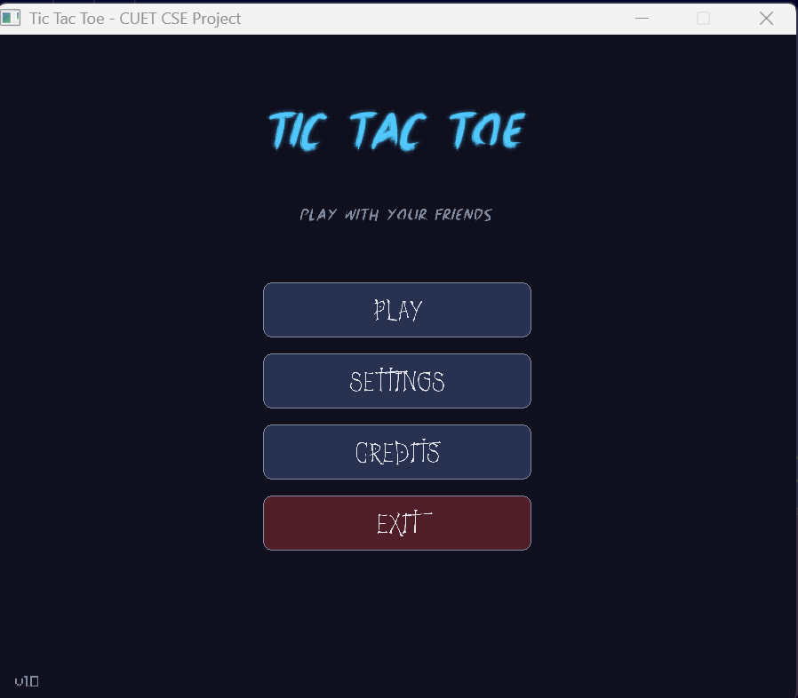
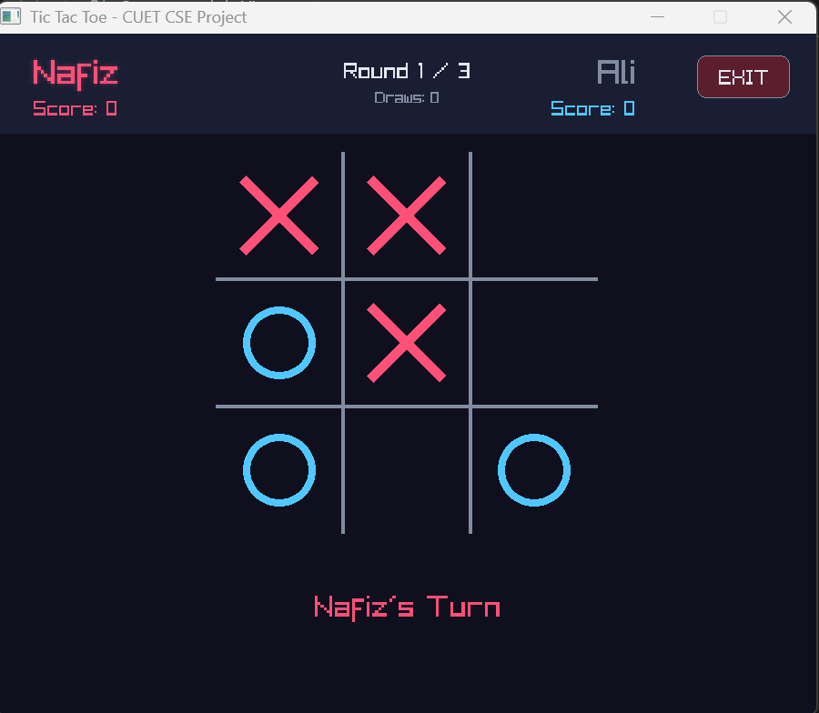
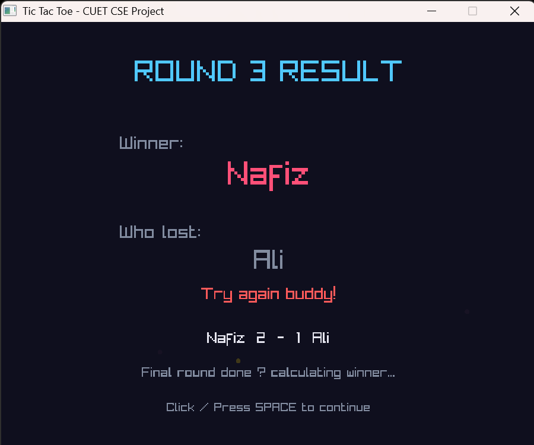
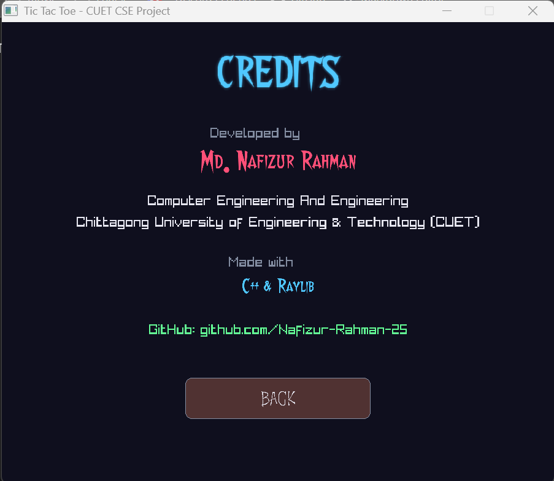

<div align="center">

# 🎮 TIC TAC TOE

### A Modern, Feature-Rich Tic Tac Toe Game

**Built with C++ & Raylib as a first-year CSE project**

[](https://isocpp.org/)
[](https://www.raylib.com/)
[](LICENSE)
[](https://www.microsoft.com/windows)

---

*A beautiful, animated, and modern take on the classic Tic Tac Toe game — designed with a dark neon theme, custom fonts, sound effects, and party cracker animations.*

</div>

---

## 📸 Screenshots

<div align="center">

### 🏠 Main Menu


### 🎯 Gameplay


### 🏆 Round Result


### 👤 Credits


</div>

---

## ✨ Features

<table>
<tr>
<td width="50%">

### 🎨 Visual Design
- 🌈 **Dark Neon Theme** — Modern, eye-catching color palette
- ✨ **Glow Effects** — Active player's name glows
- 🎉 **Party Crackers** — Particle explosion on victory
- 🎭 **Custom Fonts** — 3 unique fonts for different screens
- 💫 **Smooth Animations** — Pulsing titles, fading effects

</td>
<td width="50%">

### 🎮 Gameplay
- 👥 **Two-Player Mode** — Play with a friend
- 🔢 **Round System** — 1 to 100 rounds per match
- 🏆 **Champion Declaration** — Overall match winner
- 📊 **Score Tracking** — Wins and draws displayed live
- ⏱️ **Auto/Manual Advance** — Click or wait for next round

</td>
</tr>
<tr>
<td width="50%">

### 🔊 Audio
- 🖱️ **Click Sound** — Button feedback
- 🎯 **Place Sound** — X/O placement
- 🎵 **Win Sound** — Round victory
- 🤝 **Draw Sound** — Round tie
- 💔 **Fail Sound** — Match loss

</td>
<td width="50%">

### ⚙️ Extra Features
- 🚪 **Exit Button** — From any screen
- 🎬 **Credits Screen** — About the developer
- 🔊 **Sound Toggle** — Enable/disable sound
- 🔄 **Full Restart** — Fresh match anytime
- 🎯 **Clean State Machine** — Well-organized code

</td>
</tr>
</table>

---

## 🎮 How to Play

### Quick Start

1. **🎬 Launch the game** → Click `PLAY`
2. **✍️ Enter names** → Type Player 1 and Player 2 names
3. **🔢 Choose rounds** → Pick 1, 3, 5, 10 or type any number (1-100)
4. **🚀 Start match** → Click `START MATCH`
5. **🎯 Place marks** → Click any cell to place X or O
6. **🏆 Win rounds** → First to 3 in a row wins the round
7. **👑 Become champion** → Player with most wins wins the match

### Keyboard Shortcuts

| Key | Action |
|-----|--------|
| `TAB` | Switch between name fields |
| `ENTER` | Confirm / Continue |
| `SPACE` | Skip to next round |
| `M` | Back to main menu |
| `R` | Restart current match |
| `ESC` | Close the game |

---

## 🛠️ Technologies Used

<div align="center">

| Technology | Purpose |
|------------|---------|
|  | Core game logic |
|  | Graphics, sound, input |
|  | Compiler (MinGW-w64) |
|  | Build environment |
|  | Code editor |
|  | Version control |

</div>

---

## 📁 Project Structure

```
TicTacToe-Raylib/
│
├── main.cpp                    # Main game source
├── README.md                   # Project documentation
├── .gitignore                  # Git ignore rules
├── LICENSE                     # MIT License
│
├── fonts/                      # Custom fonts
│   ├── Walshes.ttf             # Credits screen font
│   ├── BlackUnicorn.ttf        # Title / heading font
│   └── Death.ttf               # Button font
│
├── sounds/                     # Sound effects
│   ├── click.wav               # Button click sound
│   ├── place.wav               # X/O placement sound
│   ├── win.wav                 # Round victory sound
│   ├── draw.wav                # Round tie sound
│   └── fail.wav                # Match loss sound
│
└── screenshots/                # Game screenshots
    ├── main-menu.png
    ├── gameplay.png
    ├── round-result.png
    └── credits.png
```

---

## 🚀 How to Build and Run

### Prerequisites

Make sure you have installed:

- ✅ **[MSYS2](https://www.msys2.org/)** — Build environment
- ✅ **GCC Compiler** — Via MSYS2 UCRT64
- ✅ **Raylib 6.0** — Graphics library

### Step 1: Install MSYS2 Packages

Open **MSYS2 UCRT64** terminal and run:

```bash
pacman -S mingw-w64-ucrt-x86_64-gcc
pacman -S mingw-w64-ucrt-x86_64-raylib
pacman -S mingw-w64-ucrt-x86_64-pkg-config
```

### Step 2: Clone the Repository

```bash
git clone https://github.com/Nafizur-Rahman-25/TicTacToe-Raylib.git
cd TicTacToe-Raylib
```

### Step 3: Compile

**Option A (Using PowerShell):**
```powershell
g++ main.cpp -o game.exe -I"C:\msys64\ucrt64\include" -L"C:\msys64\ucrt64\lib" -lraylib -lopengl32 -lgdi32 -lwinmm
```

**Option B (Using MSYS2 UCRT64):**
```bash
g++ main.cpp -o game.exe $(pkg-config --cflags --libs raylib) -lopengl32 -lgdi32 -lwinmm
```

### Step 4: Run

```bash
./game.exe
```

---

## 🎯 Roadmap

- [x] ✅ Basic Tic Tac Toe game
- [x] ✅ Multi-round matches (1-100)
- [x] ✅ Score tracking system
- [x] ✅ Custom fonts integration
- [x] ✅ Sound effects
- [x] ✅ Party cracker animations
- [x] ✅ Modern dark neon theme
- [ ] 🌐 Web version (HTML5 + JavaScript)
- [ ] 🎮 Online multiplayer with link sharing
- [ ] 🤖 AI opponent (Minimax algorithm)
- [ ] 📊 Save/load game statistics
- [ ] 🌍 Multi-language support (Bangla, English)

---

## 🤝 Contributing

Contributions, issues, and feature requests are welcome!

1. Fork the project
2. Create your feature branch (`git checkout -b feature/AmazingFeature`)
3. Commit your changes (`git commit -m 'Add some AmazingFeature'`)
4. Push to the branch (`git push origin feature/AmazingFeature`)
5. Open a Pull Request

---

## 📜 License

This project is licensed under the **MIT License** — see the [LICENSE](LICENSE) file for details.

---

## 👨‍💻 Author

<div align="center">

### **Md. Nafizur Rahman**

**Computer Science and Engineering**  
**Chittagong University of Engineering and Technology (CUET)**

[](https://github.com/Nafizur-Rahman-25)

</div>